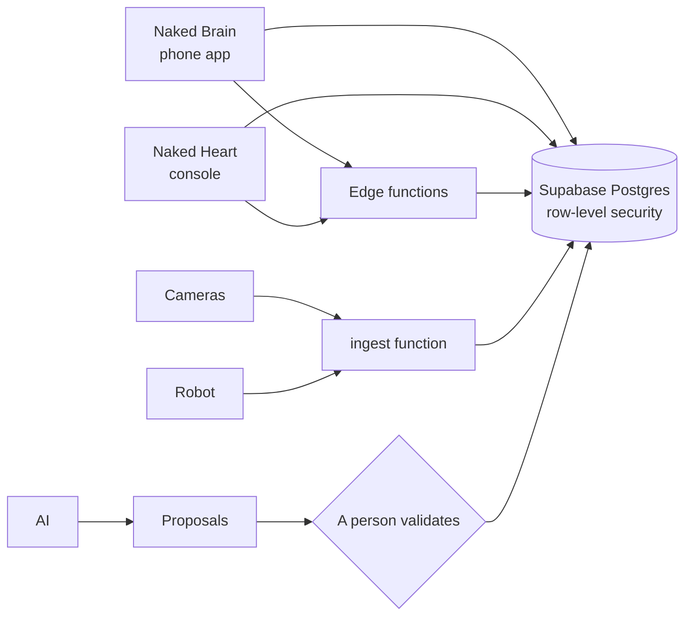

# Naked Farms · FarmBox

**Software for hydroponic greenhouse farms**

FarmBox is one database and two apps. A single Postgres platform (Supabase, with row-level security) holds the farm's crops, tasks, harvest, climate, pests and costs; a desktop console and a phone app work on the same data, so the office and the crew always see the same farm.

The system proposes, a person validates. The phone app is offline-first: crews keep working in the greenhouse without signal and everything syncs when they are back in range. AI suggestions, from scouting photos to plans, are always proposals that a person reviews before anything changes.

| App | What it is | Live | Repository |
|---|---|---|---|
| **Naked Heart** | Desktop console for managers: planning, operations, costs, team | [heart.nkd.farm](https://heart.nkd.farm) | [Nkdfarm/farmbox-console](https://github.com/Nkdfarm/farmbox-console) |
| **Naked Brain** | Phone PWA for crews: tasks, SOPs, scouting, harvest, voice notes | [brain.nkd.farm](https://brain.nkd.farm) | [Nkdfarm/naked-brain](https://github.com/Nkdfarm/naked-brain) |

## Architecture

## Stack

Postgres / Supabase · plain ES-module PWAs · Deno edge functions · Cloudflare · Python for vision and robotics

The platform, vision and robotics work are in private repositories; access on request. More at [nkd.farm](https://nkd.farm).
